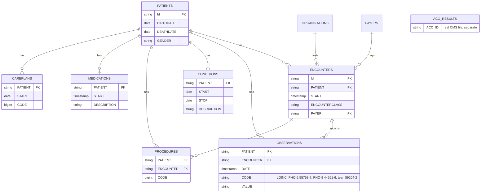

# Patients May Be Getting Better, but They Aren't Given the Survey That Proves It

### Why Torrance Memorial's depression scores are low, and three small fixes: real Medicare data, simulated patient records, and tested recommendations

**Interactive dashboard:** https://claude.ai/artifact/YaLXFSWQqR4bV7pUkPseua

**Start here (PDFs):** [One-page summary](Summary_Depression_Care_Gap_Nancy_Yeo.pdf) · [A3 improvement plan](A3_Depression_Remission_Gap_Nancy_Yeo.pdf) · [Charts](Charts_Appendix_Depression_Care_Gap_Nancy_Yeo.pdf)

## In plain words

> **Patients may be getting better, but they aren't given the survey that proves it.**

- **The problem (real Medicare data, 2024):** Torrance Memorial's doctors' network is in the top 5% nationally for blood pressure, but near the bottom for depression. Only 7 in 100 depressed patients are counted as recovered after a year; a typical network counts 14.
- **Why:** recovery can only be counted with a full 9-question depression survey (the PHQ-9). Most adults only get a short 2-question version (the PHQ-2), so patients who get better often can't be counted. In simulated records, only 2 in 100 adults were counted as recovered, compared with 67 in 100 teens, who get the full survey at every checkup.
- **The fix:** three small changes to the medical-records system: give the full survey a year later to past high scorers, require a depression check at every yearly checkup, and add a box to record the score at pregnancy visits.
- **Real vs. simulated:** the Medicare numbers are real. Patient-level data is simulated, because real records are private, so the finding is a strong lead to confirm with Torrance Memorial's own data.

The rest of this page is the technical version: the SQL, the validation, and the method behind every number.

> **Real vs. simulated.** Torrance Memorial's quality results come from **real, public CMS data**. All patient-level analysis uses **simulated EHR data** (Synthea, no real patients). Simulated results show the method and the likely causes; they are **not** Torrance Memorial's actual performance.

---

## Skills map

What the work product was asked to show, and where to find it.

| Requested skill | What I did | Where to see it |
| --- | --- | --- |
| **Data mining our EHR** | SQL across 9 EHR tables (373,688 encounters, 4.3 million observations). Found PHQ results by **LOINC code**, matched screens to visits by encounter ID, and rebuilt two CMS eCQMs (time windows, exclusions, follow-up logic) from raw records | [`queries/04_measure_134.sql`](queries/04_measure_134.sql), [`05_measure_370.sql`](queries/05_measure_370.sql) |
| **Data validation** | 14 integrity checks, a 10-patient hand check (simulated chart abstraction) that **caught 2 bugs before results were used**, exact denominator reconciliation, time-zone and reproducibility fixes. Dropped a first analysis (readmissions) when validation showed the data couldn't support it | [`validation_log.md`](validation_log.md), [`03_validation_checks.sql`](queries/03_validation_checks.sql), [`06_hand_check.sql`](queries/06_hand_check.sql) |
| **Data analysis** | Root-cause Pareto, what-if scenarios for 8 fixes at 50% and 100% adoption, sensitivity testing across three assumptions, equity breakdowns, significance tests on every claimed difference | [`07_root_cause.sql`](queries/07_root_cause.sql), [`08_levers.sql`](queries/08_levers.sql), [`09_equity.sql`](queries/09_equity.sql), [`stats.py`](stats.py) |
| **Data visualization** | 6-view Tableau story: one message per view, one accent color, captions that state the finding with its number | Tableau link above, [`tableau_build_guide.md`](tableau_build_guide.md) |
| **Healthcare environment and operations** | Medicare Shared Savings Program and ACO quality scoring, CMS measures 134 and 370, benchmarking against 476 ACOs, Torrance Memorial's 2025–2028 community health priorities, Lean (Pareto, run chart, sequenced PDSA-ready fixes), EHR workflow levers (alerts, registries, templates) | Sections 2, 8, 10 below |

---

## 1. Executive summary

**Problem.** Torrance Memorial's Medicare ACO beats 95% of ACOs nationally on blood-pressure control, but sits at the 19th percentile on both depression measures. Depression remission is **7.41%**, against a national median of **14.29%** (real CMS 2024 data).

**Finding.** Rebuilt from simulated EHR data, the remission measure turns out to be largely tracking *which screening tool a patient gets*. Teens get the full PHQ-9 at checkups, and 67.2% are measured as in remission. Adults get the 2-question PHQ-2 first. 70.8% of adults come back and are screened at 12 months, but only 12.3% get the PHQ-9 that can show remission, so measured remission is 1.9%.

**Recommendation.** Three low-effort EHR changes:
1. Hard-stop screening at every annual wellness exam.
2. A score field in prenatal and postnatal templates.
3. A registry rule that gives a PHQ-9, not a PHQ-2, at 10–14 months to anyone who previously scored 10+.

In the simulation, at half adoption, screening rises from 70.8% to 80.4%, and remission rises from 13.8% to at least 17.8% under the most pessimistic assumption. The first step is to check in Epic whether Torrance Memorial's adult workflow really does give the PHQ-2 first.

---

## 2. Business question and why it matters

**Torrance Memorial Integrated Physicians, LLC** (ACO ID A4964) is Torrance Memorial's ACO in Medicare's Shared Savings Program. In performance year 2024 it served **12,480** assigned beneficiaries, earned **$5,151,707** in shared savings, and had a quality score of **87.38**. In the Shared Savings Program, an ACO's quality performance affects how much of its earned savings it keeps, so measure gaps carry financial weight as well as clinical weight.

Compared with every ACO in the CMS 2024 results file ([`02_aco_benchmark.sql`](queries/02_aco_benchmark.sql)):

| Measure | TMIP | National median | ACOs doing worse than TMIP |
| --- | ---: | ---: | ---: |
| Controlling High Blood Pressure (236) | 90.59% | 80.24% | **95%** |
| Diabetes A1c Poor Control, lower is better (001) | 7.98% | 8.44% | 56% |
| Hospital-wide readmission, lower is better (479) | 0.1506 | 0.15 | 54% |
| Influenza Immunization (110) | 70.51% | 70.06% | 52% |
| Statin Therapy (438) | 87.45% | 87.33% | 51% |
| Falls Screening (318) | 91.57% | 91.53% | 50% |
| Breast Cancer Screening (112) | 82.03% | 82.59% | 47% |
| Colorectal Cancer Screening (113) | 76.65% | 80.23% | 36% |
| **Depression Screening & Follow-Up (134)** | **73.82%** | 83.73% | **19%** |
| **Depression Remission at 12 Months (370)** | **7.41%** | 14.29% | **19%** |

The blood-pressure result shows the care team can close a measure gap. Depression is the clear opportunity. It also fits the behavioral-health goal under "Access to Care" in Torrance Memorial's [2025–2028 Implementation Strategy](https://www.torrancememorial.org/app/files/public/66f94d24-b1a4-465c-a219-d7c97549ca95/About%20Us/Community%20Benefits/Implementation%20Strategy%202025-2028.pdf).

**The question:** where in the depression care process do patients fall out, and which fix moves the most patients for the least effort?

---

## 3. Data

| Source | Real or simulated | What it is |
| --- | --- | --- |
| [`external/aco_py2024_results.csv`](external/aco_py2024_results.csv) | **Real**, public | CMS "Performance Year Financial and Quality Results," PY2024 (revised 2026-07-17), 476 ACOs. [Source](https://data.cms.gov/sites/default/files/2026-07/fb6ba14b-3450-47c2-8ff5-d1f2a5bdb3e3/PY_Financial_and_Quality_Results_2024_revised%202026_07_17.csv) |
| Synthea EHR tables | **Simulated** | 10 runs × 1,000 living Torrance, CA residents (11,291 patients including deceased) |

**Why simulated?** Real patient data can't leave a hospital, and it shouldn't. [Synthea](https://github.com/synthetichealth/synthea) generates realistic, fully synthetic EHR records with standard codes (SNOMED, LOINC, RxNorm), so the same SQL would run against real data with table and column changes. Even so, the project works only from a **de-identified view** ([`01_deidentify.sql`](queries/01_deidentify.sql)) that drops names, SSNs, addresses, coordinates, and license and passport numbers. No patient ID appears in any exported file.

**Reproduce it exactly:**
```bash
# 1. Generate the data (needs Java 17+ and synthea-with-dependencies.jar from the Synthea releases page)
./generate_data.sh        # seeds 42-51, reference/end date fixed at 2026-10-01

# 2. Build the database and every result table (Python 3.9+, pip install duckdb pandas scipy)
python3 run_sql.py queries/0*.sql queries/10_exports.sql
python3 stats.py
```
The fixed reference date matters. Without it, the same seed produced 1,147 patients in one run and 1,148 in a later run the same day, because Synthea's clock is part of the simulation.

---

## 4. Data model



---

## 5. Method: how the measures were rebuilt

Both measures follow the CMS logic. Every simplification is listed, because a quality team would need to sign off on each one before using the numbers.

### Measure 134: Screening for Depression and Follow-Up Plan (eCQM CMS2), 2025
| Part | Rule used |
| --- | --- |
| Denominator | Patients 12+ on Jan 1, 2025 with an outpatient-type visit (ambulatory, outpatient, wellness, virtual) in 2025 |
| Exclusion | Depression or bipolar diagnosis that started before 2025 |
| Screened | A PHQ-2, PHQ-9 or teen PHQ-9 **score** recorded in the visit, or up to 14 days before it |
| Positive | PHQ-2 ≥ 3; PHQ-9 ≥ 10 |
| Follow-up (if positive) | Further assessment (PHQ-9 after a positive PHQ-2), a depression care plan, or an antidepressant start |

**Simplifications and interpretations:**
1. The visit judged is the patient's most recent 2025 screen, at the visit where it happened.
2. Follow-up is counted from the **screen date** through 2 days after the visit. CMS words it as "from the visit date." The literal reading fails patients screened (and followed up the same night) at an urgent-care visit a few days before the qualifying visit. This needs confirming against the CMS2 eCQM logic.
3. Synthea has no mental-health referral orders, so referral can't count as follow-up.
4. A "Depression screening" procedure with **no score** does not count. eCQMs read structured results.

### Measure 370: Depression Remission at 12 Months (eCQM CMS159)
| Part | Rule used |
| --- | --- |
| Index event | First PHQ-9 > 9, Nov 1, 2023 – Oct 31, 2024, patient 12+ |
| Remission | Last PHQ-9 at 12 months ± 60 days scores < 5 |
| Exclusions | Hospice or palliative care, death before the window closes, bipolar, personality, psychotic or developmental disorders |

CMS also requires an active major depression or dysthymia diagnosis. In this data, **0 patients** qualified that way: only 61 simulated patients ever get the diagnosis, and none had one active at an index PHQ-9 in the period. The analysis uses a clearly labeled **broad version** (everyone who scored 10+), giving 318 patients. The CMS version stays in the code so it would work on real data.

---

## 6. Validation

Full log: [`validation_log.md`](validation_log.md). Highlights:

- **14 integrity checks** on uniqueness, orphans, impossible dates, score ranges, the right tool for the age, and payer coverage. 11 passed clean. **3 changed how the measures are built:**
  - **1,159 "Death Certification" visits dated after death.** Synthea files death paperwork as a *wellness* visit, so these visits would have put deceased patients into the screening denominator. They're excluded.
  - **2,674 screening procedures with no recorded score.** A screen only counts when a score exists.
  - **The PHQ-2 → PHQ-9 sequence was confirmed** (only 1 PHQ-9 out of 2,636 lacked a positive PHQ-2 first).
- **10-patient hand check:** 10 of 10 matched. Checking failures first exposed **2 bugs**, both fixed:
  - A later visit's 14-day window "stole" an earlier screen, which wrongly failed 174 patients.
  - A long evening visit had scores timestamped just after midnight, so date matching separated them from their own visit. Screens are now matched by encounter ID first.
- **Denominators reconcile exactly:** 134: 5,280 + 1,805 + 335 + 39 = 7,459. 370: 44 + 195 + 47 + 32 = 318.
- **A first analysis was dropped.** The original plan studied 30-day readmissions. Validation showed that 87% of the raw "readmissions" were scheduled chemotherapy and staged heart surgery, and that true unplanned readmissions were 1.1% (vs. 12–16% in real hospitals). Synthea doesn't simulate them, so the topic changed.

Synthea is cleaner than real EHR data. In real data, I'd expect these same checks to find more.

---

## 7. Findings

All results in this section are **simulated**. Every group difference was tested ([`stats.py`](stats.py), [`data/stats_tests.csv`](data/stats_tests.csv)).

### 7.1 How do the rebuilt measures come out?
```sql
SELECT result_reason, COUNT(*) FROM m134 GROUP BY 1;   -- 04_measure_134.sql
```
| Measure | Denominator | Passed | Rate |
| --- | ---: | ---: | ---: |
| 134 Screening & follow-up (2025) | 7,459 | 5,280 | **70.8%** |
| 370 Remission at 12 months (broad) | 318 | 44 | **13.8%** |

**Takeaway:** the logic produces believable rates, and every failure carries a reason code that can be traced to a patient.

### 7.2 Where does remission break down? (the headline)
```sql
-- 10_exports.sql, cascade: each step is a subset of the one before
COUNT(*) FILTER (WHERE followup_score IS NOT NULL) AS s4_given_phq9_at_12_months
```
| Step | Adults (260) | Teens (58) |
| --- | ---: | ---: |
| Had a visit at 12 months | 85.8% | 98.3% |
| Screened at 12 months | 70.8% | 87.9% |
| **Given a PHQ-9 at 12 months** | **12.3%** | 75.9% |
| In remission | **1.9%** | 67.2% |

Teens vs. adults: 67.2% vs. 1.9%, p < 0.001.

**Takeaway:** adults aren't being lost to follow-up, because 7 in 10 come back and get screened. They're lost at the **tool**. A negative PHQ-2 means no PHQ-9 is given, and remission can only be shown with a PHQ-9. **154 adults** screened negative at 12 months and could not be counted. Among adults who *were* re-measured, only 15.6% were in remission. That figure is biased low, because they only got a PHQ-9 when their PHQ-2 was positive again.

### 7.3 Why do patients fail screening? (Pareto)
```sql
-- 07_root_cause.sql
WHEN m.result_reason = 'Fail: not screened' AND w.patient_id IS NOT NULL
    THEN 'A. Had a 2025 annual wellness exam, no screen recorded'
```
| Root cause (measure 134) | Patients | Share | Cumulative |
| --- | ---: | ---: | ---: |
| A. Had an annual wellness exam, no screen recorded | 1,118 | 51.3% | 51.3% |
| B. No wellness exam; only problem or other visits | 687 | 31.5% | 82.8% |
| C. Screen documented without a score (prenatal/postnatal) | 335 | 15.4% | 98.2% |
| D. Teen positive screen, no follow-up plan | 39 | 1.8% | 100% |

Screening rate by visit type in 2025: wellness 76.7%, urgent care 52.9%, outpatient 26.4%, emergency 13.2%, **ambulatory 0.1%**, virtual 0%. Patients with a wellness exam pass 79.8% of the time, those without pass 15.3% (p < 0.001).

**Takeaway:** screening is tied to the annual exam, and even then about 1 in 6 patients who had an exam (1,118 of 6,416) weren't screened. Half of all failures happen at the visit designed for screening.

### 7.4 Who falls through?
| Age band | Pass rate | Had a 2025 wellness exam |
| --- | ---: | ---: |
| 12–17 | 74.4% | 98.2% |
| **18–34** | **53.6%** | **68.8%** |
| 35–49 | 66.6% | 79.6% |
| 50–64 | 83.5% | 98.5% |
| 65+ | 86.0% | 98.6% |

By payer: Medicare 81.2%, Dual 80.4%, uninsured 69.8%, Medicaid 66.7%, private 66.6% (all differences p < 0.001).

**Takeaway:** young adults skip the annual exam and miss the screen with it. 669 of the 687 patients in root cause B are aged 18–49.

---

## 8. Recommendation and estimated impact

### The levers ([`08_levers.sql`](queries/08_levers.sql))

**Formulas:**
- **Measure 134:** new rate = (current passes + adoption × patients reached × pass probability) ÷ denominator. Pass probability = 99.3%, the rate already seen among screened patients.
- **Measure 370:** new rate = (current remissions + adoption × patients reached × *r*) ÷ denominator. *r* is unknown, so it's tested at three values:
  - **Floor 15.6%:** adults who were re-measured, biased low.
  - **Middle 50%.**
  - **Ceiling 88.6%:** teens, who get the PHQ-9 routinely.

| Lever | Fixes | Effort | Time | Patients | 50% adoption | 100% adoption |
| --- | --- | --- | --- | ---: | ---: | ---: |
| **L1** Hard-stop PHQ-2 at every wellness exam | 134-A | Low | 1–3 mo | 1,118 | 70.8 → **78.2** | 85.7 |
| L2 Screen at any visit when overdue | 134-B | Medium | 3–6 mo | 687 | 70.8 → 75.4 | 79.9 |
| **L3** Score field in prenatal/postnatal templates | 134-C | Low | 1–2 mo | 335 | 70.8 → **73.0** | 75.2 |
| L4 Teen positive-screen behavioral health pathway | 134-D | Medium | 3–6 mo | 39 | 70.8 → 71.0 | 71.3 |
| **M1** Registry: PHQ-9 (not PHQ-2) at 10–14 months for a prior PHQ-9 of 10+ | 370-A | Low | 1–3 mo | 161 | 13.8 → **17.8–36.3** | 21.7–58.7 |
| M2 Same alert at any visit in the window | 370-B | Low | 1–3 mo | 45 | 13.8 → 14.9–20.1 | 16.0–26.4 |
| M3 Portal or phone PHQ-9 outreach | 370-C | Medium | 3–6 mo | 36 | 13.8 → 14.7–18.9 | 15.6–23.9 |
| M4 Care management for patients still depressed | 370-D | High | 6–12 mo | 32 | not estimable from this data | — |

### The decision
**Phase 1 (months 1–3): L1 + L3 + M1.** All three are low-effort EHR configuration changes: an alert, a template field and a registry rule. All three work at visits that already happen.

| Package | Now | 50% adoption | 100% adoption |
| --- | ---: | ---: | ---: |
| Measure 134 (L1 + L3) | 70.8% | **80.4%** | 90.1% |
| Measure 370 (M1), pessimistic | 13.8% | **17.8%** | 21.7% |
| Measure 370 (M1), middle | 13.8% | 26.5% | 39.2% |

**Phase 2 (months 3–6): L2.** This is the equity fix for young adults, who need screening at problem and urgent visits. **Then** M3 and L4. M4 is a staffing decision with its own business case.

### Why this is the right call, and what would change it
- **It holds up under pessimistic assumptions.** M1 beats every other remission lever even at the pessimistic floor. L1 stays the best screening lever as long as its adoption is at least 61% of L2's.
- **It's cheap and reversible.** These are configuration changes, not new staff. If one doesn't work, it can be switched off.
- **It can be checked quickly.** Wellness-exam screening has held at 76.7–76.9% a year for three years (monthly range 72.8–80.5%). A month above 80.5% after go-live is the first signal L1 is working ([`data/monthly.csv`](data/monthly.csv)). For M1, the leading indicator is the share of flagged patients given a PHQ-9 at 10–14 months.
- **What would change the decision:** if Torrance Memorial's Epic data shows adults *already* get a PHQ-9 at follow-up, M1 drops out. In that case the remission gap is clinical (treatment), M4 moves up, and the case for collaborative care needs to be built. **Checking this in Epic is step one.**

---

## 9. Limitations

- **Simulated data.** Synthea follows rule-based care pathways. The PHQ-2-first workflow is how *Synthea* works; whether Torrance Memorial's clinics work the same way is the hypothesis to test, not a fact.
- **Population mismatch.** The ACO's measures cover Medicare beneficiaries. The simulation covers all ages 12+. Simulated Medicare patients screen at 81.2%, against 70.8% overall.
- **CMS 370 as specified had 0 eligible patients.** The broad version is a stand-in.
- **Follow-up timing interpretation** (from the screen date, not the visit date) needs sign-off.
- **The remission rate for re-measured patients (*r*) is unknown.** That's why it's shown as a range.
- **Confounding:** socially isolated patients screened *more* (75.7% vs 68.4%), probably because isolation is recorded at the same wellness exams. It's not reported as a finding.
- **Effort, time and risk ratings are judgments,** with the reason stated for each so they can be challenged.
- **Association, not causation.** The levers' effects are estimates. A pilot with a run chart is the real test.
- **No referral, scheduling or no-show data** in Synthea.

---

## 10. What I'd do with Torrance Memorial's real EHR data (first 90 days)

1. **Test the headline (weeks 1–2).** Pull adult PHQ-2 and PHQ-9 results from Epic Clarity (questionnaire or flowsheet results joined to `PAT_ENC` encounters) for patients with a PHQ-9 of 10+. Do they get a PHQ-9 at 10–14 months, or only a PHQ-2? This one query confirms or kills M1.
2. **Reconcile with the ACO's submission (weeks 2–4).** Re-run measures 134 and 370 with the same logic and compare patient-level results with what the ACO reported to CMS. Mismatches show where documentation, not care, is losing credit (like the 2,674 unscored screens here).
3. **Pareto on real failures (weeks 3–6).** Same root-cause tags, real counts, split by clinic and provider.
4. **Pilot (months 2–3).** Build M1 as a registry rule (for example in Epic Healthy Planet) at one or two clinics. Track the run chart monthly and spread it if the signal appears.
5. **Add what Synthea lacks:** behavioral health referrals and completion, appointment no-shows, and social-needs screening, to size M3, L4 and M4.

---

## 11. Repo structure

```
├── README.md                    ← you are here
├── Summary_…pdf / A3_…pdf / Charts_Appendix_…pdf   ← the three documents to read first
├── summary.md, pdsa_a3.md      ← the same summary and A3 as text
├── validation_log.md
├── tableau_build_guide.md
├── generate_data.sh             ← reproduces the simulated data
├── run_sql.py                   ← runs the .sql files (fixed time zone)
├── stats.py                     ← significance tests
├── external/aco_py2024_results.csv   ← real CMS data
├── queries/
│   ├── 00_load.sql              01_deidentify.sql        02_aco_benchmark.sql
│   ├── 03_validation_checks.sql 04_measure_134.sql       05_measure_370.sql
│   ├── 06_hand_check.sql        07_root_cause.sql        08_levers.sql
│   ├── 09_equity.sql            10_exports.sql
├── data/                        ← exported CSVs for Tableau (no patient-level data)
├── dashboard/                   ← the dashboard page, and the HTML behind each PDF
└── images/                      ← Tableau screenshots
```

---

*Built with DuckDB SQL, Python (scipy) and an interactive web dashboard. I used Claude Code as a pair analyst for writing and debugging SQL. The analytical decisions (dropping readmissions, choosing the measures, approving exclusions, choosing the headline) and the interpretation are mine, and I can walk through every query.*
